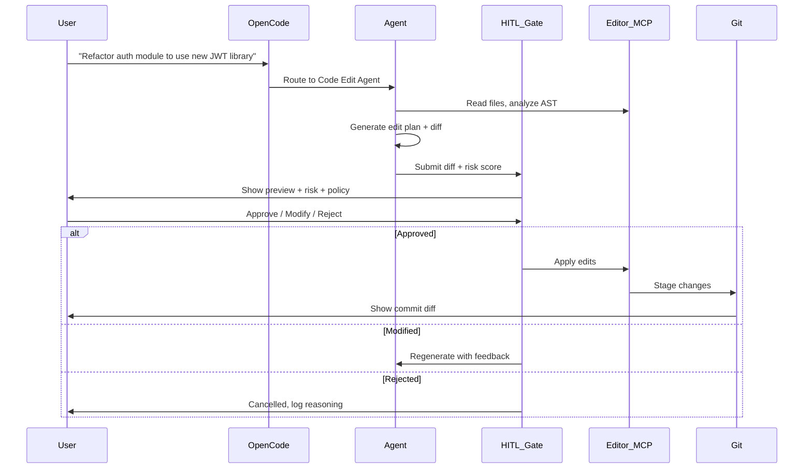

# AI-Powered Editing Automation Architecture

## Overview
Human-in-the-loop editing automation system using OpenCode as the orchestration layer, connecting to various editing tools (IDEs, text editors, document editors) with approval gates.

---

## High-Level Architecture

```
┌─────────────────────────────────────────────────────────────────────────────┐
│                           USER INTERFACE LAYER                              │
├─────────────────────────────────────────────────────────────────────────────┤
│  ┌─────────────┐  ┌─────────────┐  ┌─────────────┐  ┌─────────────┐        │
│  │   CLI/TUI   │  │  VS Code    │  │  Web UI     │  │  Custom     │        │
│  │  (opencode) │  │  Extension  │  │  (Dashboard)│  │  Editor     │        │
│  └──────┬──────┘  └──────┬──────┘  └──────┬──────┘  └──────┬──────┘        │
└─────────┼────────────────┼────────────────┼────────────────┼────────────────┘
          │                │                │                │
          ▼                ▼                ▼                ▼
┌─────────────────────────────────────────────────────────────────────────────┐
│                        ORCHESTRATION LAYER (OpenCode)                       │
├─────────────────────────────────────────────────────────────────────────────┤
│  ┌─────────────────────────────────────────────────────────────────────┐   │
│  │                     AGENT REGISTRY & ROUTER                         │   │
│  │  ┌────────────┐ ┌────────────┐ ┌────────────┐ ┌────────────┐      │   │
│  │  │ Code Edit  │ │ Content    │ │ Doc/Tech   │ │ Refactor/  │      │   │
│  │  │ Agent      │ │ Edit Agent │ │ Write Agent│ │ Transform  │      │   │
│  │  │            │ │            │ │            │ │ Agent      │      │   │
│  │  └────────────┘ └────────────┘ └────────────┘ └────────────┘      │   │
│  └─────────────────────────────────────────────────────────────────────┘   │
│                                    │                                        │
│                                    ▼                                        │
│  ┌─────────────────────────────────────────────────────────────────────┐   │
│  │                    HUMAN-IN-THE-LOOP GATE                           │   │
│  │  ┌─────────────┐  ┌─────────────┐  ┌─────────────┐  ┌───────────┐  │   │
│  │  │ Diff Preview│  │ Risk Score  │  │ Policy Check│  │ Approve/  │  │   │
│  │  │ (Unified)   │  │ (Auto)      │  │ (Rules)     │  │ Reject/   │  │   │
│  │  │             │  │             │  │             │  │ Modify    │  │   │
│  │  └─────────────┘  └─────────────┘  └─────────────┘  └───────────┘  │   │
│  └─────────────────────────────────────────────────────────────────────┘   │
│                                    │                                        │
└────────────────────────────────────┼────────────────────────────────────────┘
                                     │
          ┌──────────────────────────┼──────────────────────────┐
          ▼                          ▼                          ▼
┌─────────────────┐        ┌─────────────────┐        ┌─────────────────┐
│   EDITING TOOL  │        │   EDITING TOOL  │        │   EDITING TOOL  │
│   ADAPTERS      │        │   ADAPTERS      │        │   ADAPTERS      │
├─────────────────┤        ├─────────────────┤        ├─────────────────┤
│ • VS Code       │        │ • JetBrains     │        │ • Google Docs   │
│ • Cursor        │        │ • Neovim        │        │ • Notion        │
│ • Zed           │        │ • Helix         │        │ • Obsidian      │
│ • GitHub Web    │        │ • Emacs         │        │ • Confluence    │
└─────────────────┘        └─────────────────┘        └─────────────────┘
          │                          │                          │
          ▼                          ▼                          ▼
┌─────────────────────────────────────────────────────────────────────────────┐
│                         EXECUTION & STATE LAYER                             │
├─────────────────────────────────────────────────────────────────────────────┤
│  ┌──────────────┐  ┌──────────────┐  ┌──────────────┐  ┌──────────────┐   │
│  │ Git/Ops      │  │ Session/     │  │ Audit/       │  │ Policy/      │   │
│  │ Manager      │  │ Context Store│  │ Telemetry    │  │ Rules Engine │   │
│  └──────────────┘  └──────────────┘  └──────────────┘  └──────────────┘   │
└─────────────────────────────────────────────────────────────────────────────┘
```

---

## Core Components

### 1. Agent Registry & Router
Routes editing tasks to specialized agents based on:
- File type / language
- Task complexity
- User preferences
- Historical success patterns

### 2. Specialized Editing Agents

| Agent | Purpose | Tools |
|-------|---------|-------|
| **Code Edit Agent** | Source code modifications, refactoring, bug fixes | LSP, AST, git |
| **Content Edit Agent** | Prose, docs, markdown, copy editing | Lint, style guides |
| **Doc/Tech Write Agent** | Technical documentation, API docs, READMEs | Specs, examples |
| **Refactor/Transform Agent** | Large-scale migrations, codemods, pattern updates | AST, codemod tools |

### 3. Human-in-the-Loop Gate (Critical)
Every edit passes through:
1. **Unified Diff Preview** - Side-by-side, inline, or semantic diff
2. **Risk Scoring** - Auto-calculated (blast radius, test coverage, criticality)
3. **Policy Check** - Org rules (no prod DB changes, no secrets, etc.)
4. **Approval UI** - Approve / Reject / Modify / Defer

### 4. Editing Tool Adapters (MCP Servers)
Each editor/IDE connects via MCP (Model Context Protocol):

```yaml
# Example: .opencode/mcp/servers.yaml
servers:
  vscode:
    command: "npx"
    args: ["@vscode/mcp-server"]
    tools: ["edit_file", "read_file", "search", "run_task", "get_diagnostics"]
  
  cursor:
    command: "cursor-mcp-server"
    tools: ["edit", "chat", "composer"]
  
  google_docs:
    command: "gdocs-mcp-server"
    env:
      GOOGLE_CREDENTIALS: "${GOOGLE_CREDENTIALS}"
    tools: ["read_doc", "write_doc", "suggest_edits"]
  
  notion:
    command: "notion-mcp-server"
    env:
      NOTION_TOKEN: "${NOTION_TOKEN}"
    tools: ["read_page", "update_page", "create_page"]
```

---

## Workflow: Human-in-the-Loop Edit



---

## Configuration Structure

```
.opencode/
├── agents/
│   ├── code-edit.yaml       # Code editing agent config
│   ├── content-edit.yaml    # Content editing agent config
│   ├── doc-write.yaml       # Documentation agent config
│   └── refactor.yaml        # Refactoring agent config
├── mcp/
│   └── servers.yaml         # Editor/Tool MCP servers
├── policies/
│   ├── risk-rules.yaml      # Risk scoring rules
│   ├── approval-rules.yaml  # When human approval required
│   └── org-policies.yaml    # Org-specific guardrails
├── workflows/
│   ├── quick-edit.yaml      # Low-risk, auto-approve
│   ├── standard-edit.yaml   # Normal flow with HITL
│   └── major-refactor.yaml  # Multi-step, multi-approval
└── settings.yaml            # Global settings
```

---

## Risk Scoring Model

```yaml
# .opencode/policies/risk-rules.yaml
risk_factors:
  file_criticality:
    - pattern: "**/auth/**"          weight: 10
    - pattern: "**/payment/**"       weight: 10
    - pattern: "**/database/**"      weight: 8
    - pattern: "**/config/**"        weight: 6
    - pattern: "**/*.test.*"         weight: -3
    - pattern: "**/*.spec.*"         weight: -3
  
  change_magnitude:
    lines_added:
      - "> 500": 10
      - "100-500": 6
      - "50-100": 3
      - "< 50": 1
    files_changed:
      - "> 10": 8
      - "5-10": 4
      - "2-4": 2
      - "1": 0
  
  test_coverage:
    - "< 50%": 8
    - "50-80%": 4
    - "> 80%": 0
  
  blast_radius:
    - "public_api": 10
    - "internal_api": 6
    - "implementation": 2

approval_thresholds:
  auto_approve: "< 15"
  human_review: "15-35"
  multi_approver: "35-60"
  block: "> 60"
```

---

## Quick Start: Minimal Setup

### 1. Install OpenCode
```bash
# If not already installed
curl -fsSL https://opencode.ai/install.sh | sh
```

### 2. Initialize Project
```bash
cd "C:\Users\rishi\OneDrive\Documents\Portfolio Site"
opencode init
```

### 3. Configure MCP Servers for Your Editors
```bash
# VS Code
code --install-extension vscode.mcp

# Or use the MCP server directly
npx @vscode/mcp-server
```

### 4. Create Agent Configs
```yaml
# .opencode/agents/code-edit.yaml
agent:
  name: "code-edit"
  model: "anthropic/claude-3.5-sonnet"
  system_prompt: |
    You are a precise code editing agent. 
    - Make minimal, focused changes
    - Preserve existing style and patterns
    - Write tests for new behavior
    - Output unified diffs only
  tools:
    - read_file
    - write_file
    - edit_file
    - search
    - run_command
    - get_diagnostics
  mcp_servers: ["vscode", "git"]
```

### 5. Run Your First Edit
```bash
opencode run "Add JSDoc comments to all exported functions in src/utils/"
# → Shows diff → You approve → Applies to VS Code
```

---

## Advanced: Custom Editing Workflows

### Workflow: Multi-File Refactor with Staged Approvals
```yaml
# .opencode/workflows/major-refactor.yaml
workflow:
  name: "major-refactor"
  steps:
    - name: "analyze"
      agent: "code-edit"
      prompt: "Analyze impact of migrating from X to Y across codebase"
      output: "impact_report.md"
      approval: required
    
    - name: "plan"
      agent: "refactor"
      prompt: "Create detailed migration plan with file list and order"
      input: "impact_report.md"
      output: "migration_plan.yaml"
      approval: required
    
    - name: "execute-batch"
      agent: "refactor"
      prompt: "Execute migration for batch {{batch_number}}"
      input: "migration_plan.yaml"
      loop:
        over: "batches"
        approval_per_iteration: true
        max_parallel: 1
    
    - name: "validate"
      agent: "code-edit"
      prompt: "Run tests, check for regressions, generate report"
      approval: required
    
    - name: "commit"
      agent: "git-manager"
      prompt: "Create PR with migration summary"
      auto_merge: false
```

---

## Integration Patterns

### Pattern 1: Chat-Driven (Current OpenCode)
```
You: "Fix the type error in UserService.ts"
Agent: [Shows diff] → You: "Looks good, apply"
```

### Pattern 2: Background Agent (Async)
```bash
opencode spawn --background "Refactor all API routes to use new middleware"
# → Runs in background, notifies when ready for review
```

### Pattern 3: Scheduled Maintenance
```yaml
# .opencode/schedules.yaml
schedules:
  - name: "weekly-docs-sync"
    cron: "0 2 * * 1"  # Monday 2am
    workflow: "doc-sync"
    auto_approve: true  # Low risk
```

### Pattern 4: Git Hook Integration
```bash
# .git/hooks/pre-push
opencode check --policy pre-push --fail-on high-risk
```

---

## Security & Governance

| Layer | Mechanism |
|-------|-----------|
| **Data** | No code leaves your machine (local models) or uses approved providers |
| **Secrets** | Automatic redaction in diffs, never sent to LLM |
| **Audit** | Full trail: request → plan → diff → approval → execution → result |
| **Policies** | Declarative rules, version-controlled, testable |
| **Rollback** | One-click git revert, editor undo, state snapshots |

---

## Metrics & Observability

```yaml
# .opencode/telemetry.yaml
telemetry:
  enabled: true
  events:
    - edit_requested
    - diff_generated
    - approval_given
    - approval_rejected
    - edit_applied
    - edit_failed
    - rollback_triggered
  metrics:
    - time_to_approval
    - approval_rate
    - edit_success_rate
    - lines_changed_per_session
    - risk_score_distribution
  export:
    - console
    - file: ".opencode/logs/telemetry.jsonl"
    - otlp: "http://localhost:4318"  # Optional
```

---

## Next Steps

1. **Start Simple**: Configure VS Code MCP, create one agent, try a few edits
2. **Add Policies**: Define your risk rules and approval thresholds
3. **Expand Adapters**: Add Notion, Google Docs, or other editors you use
4. **Build Workflows**: Create reusable workflows for common patterns
5. **Measure & Iterate**: Track metrics, refine agents, adjust policies

---

## Resources

- [OpenCode Docs](https://opencode.ai/docs)
- [MCP Specification](https://modelcontextprotocol.io)
- [VS Code MCP Extension](https://marketplace.visualstudio.com/items?itemName=vscode.mcp)
- [Agent Design Patterns](https://opencode.ai/docs/agents)